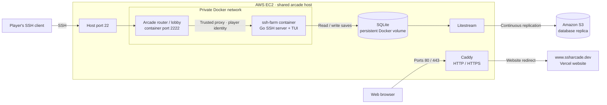
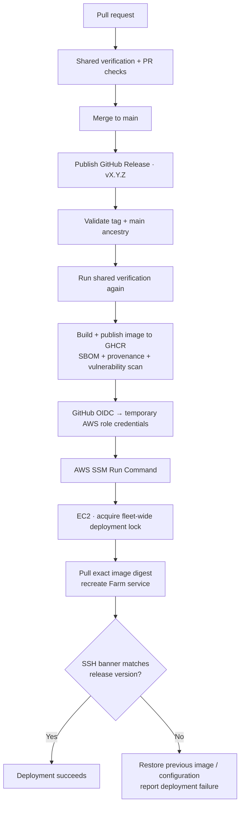

# ssh-farm

```bash
ssh ssharcade.dev
```

**Select FARM in the arcade lobby to play.** Bring a terminal and an SSH client;
there is nothing to install beyond that. Your SSH public key identifies your
account and saved farm.


**A terminal farming game, built and shipped as part of a live SSH arcade on AWS.**
Plant crops, trade at the market, expand your land, and rebirth for permanent
upgrades. Play with the keyboard or mouse, compete on the leaderboard, and work
through a three-contract endgame campaign.

[](https://github.com/MyNameIs-Nigel/ssh-farm/actions/workflows/ci.yml)
[](https://github.com/MyNameIs-Nigel/ssh-farm/actions/workflows/release.yml)

## From source code to a live arcade

I built ssharcade to learn the full path from writing a game to operating a
fleet of services: packaging Go applications, connecting private containers,
persisting player data, and deploying releases to EC2 through GitHub Actions.
Farm is one of three games behind a shared SSH lobby on a single host.

SSH makes the arcade distinctive and easy to reach wherever an SSH client and
network access are available. It also gives players public-key authentication
without a separate password or registration flow. The intended audience is
anyone comfortable in a terminal, especially people who already use SSH.

The infrastructure is deliberately small. The shared EC2 instance costs me
**less than $10/month** for compute; that figure excludes other AWS services.
The interesting work is making that small deployment reproducible, observable
through release checks, and recoverable when a release fails.

## Architecture

The host exposes SSH on port 22. The lobby authenticates players and forwards
their identity to Farm over a private Docker network. Farm has no published host
port in the production fleet.



Caddy handles the web side of the shared hostname. SSH connections go directly
to the lobby. The fleet's Compose configuration and game registry are owned by
[ssh-arcadelobby](https://github.com/MyNameIs-Nigel/ssh-arcadelobby/tree/main/deploy).

## Release deployments with GitHub OIDC and AWS SSM

The part I am proudest of is getting the fleet from a GitHub release to a
running game on EC2 without manually connecting to the host for each deploy.
**GitHub Actions authenticates to AWS through OIDC**, exchanging a workflow
identity token for temporary IAM role credentials. The deployment job needs no
long-lived AWS access key and uses SSM Run Command rather than an inbound SSH
connection from the runner.



- **Explicit releases:** merging runs CI; publishing a non-prerelease
  `vMAJOR.MINOR.PATCH` GitHub Release starts delivery. The tagged commit must be
  reachable from `main`.
- **One verification contract:** CI and releases call the same reusable
  workflow. Checks include builds, static analysis, race tests on Linux and
  Windows, and coverage gates. PRs also have an 85% changed-line coverage gate.
- **Checks before deployment:** source secret scanning and vulnerability checks
  run in CI. Published images carry an SBOM and provenance attestation, and a
  high/critical vulnerability scan blocks deployment for findings with fixes.
- **Reproducible deployment:** production selects the published image by its
  immutable digest. A host-wide lock serializes deployments across all four
  repositories, and Farm's release recreates only Farm.
- **Failure handling:** the host probes the running SSH banner for the expected
  version. A failed rollout attempts to restore the previous image and
  configuration, while the workflow still reports failure.

In my observed runs, the **deploy job takes about 28 seconds**, excluding the
preceding verification and image build. Container replacement briefly interrupts
Farm sessions and returns players to the lobby; they can re-enter once Farm is
ready, with their saved progress retained. Deployments reuse the data volume.
This is a brief service interruption rather than a rolling deployment.

The [release runbook](docs/releasing.md),
[release workflow](.github/workflows/release.yml), and
[host deployment script](scripts/deploy/remote-deploy.sh) contain the implementation
and recovery details. Image/configuration rollback does not roll back a database
migration; incompatible data changes need their own recovery plan.

## Engineering decisions

| Choice | Reason and tradeoff |
| --- | --- |
| One EC2 host, multiple containers | Keeps the fleet affordable and straightforward to operate. The host remains a shared failure domain. |
| Shared SSH router, private game services | Gives players one entry point and centralizes authentication. Games trust only the configured proxy to forward player identity. |
| SQLite with Litestream → S3 | Keeps storage local and simple while continuously replicating saves off the host. Replication is asynchronous, so host failure can lose recent unreplicated writes. |
| Non-root containers with read-only root filesystems | Restricts application writes to designated storage mounts. |
| External moderation configuration | Keeps the production denylist out of source and images. Production refuses to boot without valid required moderation configuration. |

The game uses **Go, Wish v2, Bubble Tea v2, Lip Gloss v2, modernc SQLite, and
Litestream**, packaged with Docker Compose and delivered through GitHub Actions,
GHCR, IAM/OIDC, and AWS Systems Manager.

## Documentation

The [documentation index](docs/README.md) links the architecture, gameplay
specifications, persistence design, and operational runbooks. Some documents began
as implementation plans; the index distinguishes that history from shipped work.

MIT licensed — see [LICENSE](LICENSE). [NOTICE](NOTICE) covers third-party software
redistributed in the container image, including Litestream.

## Local development

Use the Go version declared in [go.mod](go.mod). From a clone of this repository:

```bash
go build ./...
go vet ./...
go test ./...

# Run on an unprivileged port, bound to this computer.
FARM_LISTEN_HOST=127.0.0.1 FARM_LISTEN_PORT=2222 go run ./cmd/ssh-farm
```

In another terminal, connect with an SSH key:

```bash
ssh -p 2222 localhost
```

Local saves and the server host key default to `var/farm.db` and
`var/ssh_host_key`. For race detection, run `go test -race ./...` with CGO and a
C compiler available.

Use a terminal with 24-bit color support; the server selects the True Color
profile without requiring `COLORTERM` forwarding. A 100×30 terminal or larger
is recommended.

With `FARM_MODERATION_PATH` unset, the server uses a placeholder fixture and
refuses player-set farm names in favor of generated ones. Production sets
`FARM_REQUIRE_MODERATION=true` and loads its private list from the host. See
[moderation design](docs/gameplay/03-farm-names-and-moderation.md).

To preview seasonal themes locally, add `FARM_DEV_SEASON=halloween` or
`FARM_DEV_SEASON=christmas` to the server command. With no override, themes follow
the normal UTC calendar windows.
