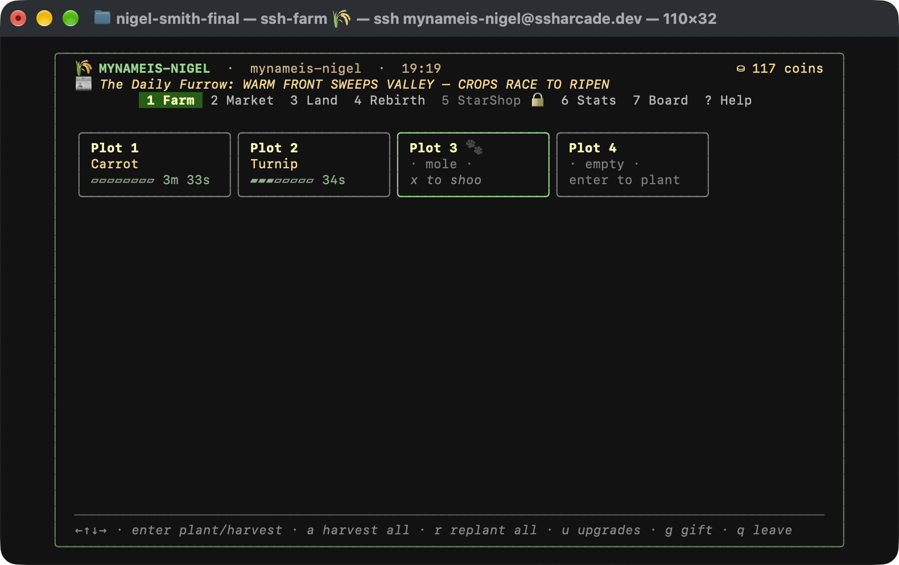
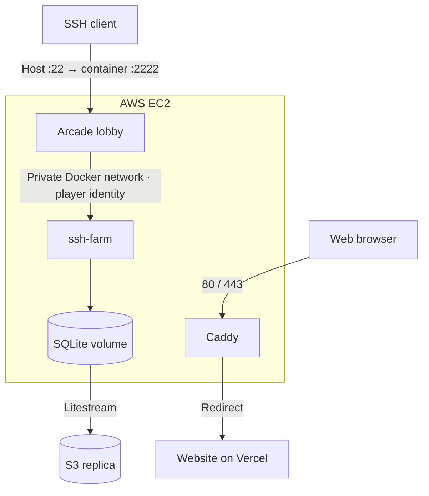

# ssh-farm

```bash
ssh ssharcade.dev
```

**Select FARM in the lobby to play.** Your SSH public key identifies your saved
farm. A terminal with 24-bit color and a 100×30 window is recommended.



Plant crops, trade, buy land, and rebirth for permanent upgrades. Keyboard and
mouse controls, leaderboards, seasonal themes, and an endgame campaign.

[](https://github.com/MyNameIs-Nigel/ssh-farm/actions/workflows/ci.yml)
[](https://github.com/MyNameIs-Nigel/ssh-farm/actions/workflows/release.yml)

## Built and shipped on AWS

I built ssharcade to learn how to take games from source code to a live service.
Farm runs alongside two other games and a shared SSH lobby on one EC2 instance,
which costs me less than $10/month for compute.

I chose SSH because it's an unusual way to play, easy to reach from a terminal,
and already has public-key authentication built in.

## Architecture



Only the lobby exposes an SSH port. Caddy handles web traffic separately.
[ssh-arcadelobby](https://github.com/MyNameIs-Nigel/ssh-arcadelobby/tree/main/deploy)
owns the fleet's Compose configuration.

## CI/CD

Publishing a GitHub Release deploys the game automatically. **GitHub Actions
uses OIDC to assume an AWS role with temporary credentials**, then sends the
deployment command to EC2 through **AWS SSM**. No stored AWS access keys or SSH
connection from the runner.

- **Verify:** shared CI/release checks, Linux and Windows race tests, coverage
  gates, secret scanning, and vulnerability checks.
- **Publish:** a GHCR image with an SBOM, provenance attestation, and image scan.
- **Deploy:** pull the exact image digest, acquire a fleet-wide lock, recreate
  Farm, and check its SSH version banner. Attempt rollback if startup fails.

The deploy job takes about **28 seconds** in my runs, after tests and the image
build. Players briefly return to the lobby during container replacement and can
rejoin with their saved progress. The data volume stays in place.

[Release workflow](.github/workflows/release.yml) ·
[Deployment script](scripts/deploy/remote-deploy.sh) ·
[Release and recovery runbook](docs/releasing.md)

## Stack and docs

Go · Wish · Bubble Tea · Lip Gloss · SQLite · Litestream · Docker Compose

[Project docs](docs/README.md) · [MIT license](LICENSE) · [Third-party notices](NOTICE)

## Local development

Use the Go version in [go.mod](go.mod):

```bash
go build ./...
go vet ./...
go test ./...
FARM_LISTEN_HOST=127.0.0.1 FARM_LISTEN_PORT=2222 go run ./cmd/ssh-farm
```

Connect from another terminal:

```bash
ssh -p 2222 localhost
```

Saves and the host key live in `var/` by default. Local moderation uses a fixture
and generated farm names; see [moderation configuration](docs/gameplay/03-farm-names-and-moderation.md).
For seasonal previews, add `FARM_DEV_SEASON=halloween` or
`FARM_DEV_SEASON=christmas` to the server command.
